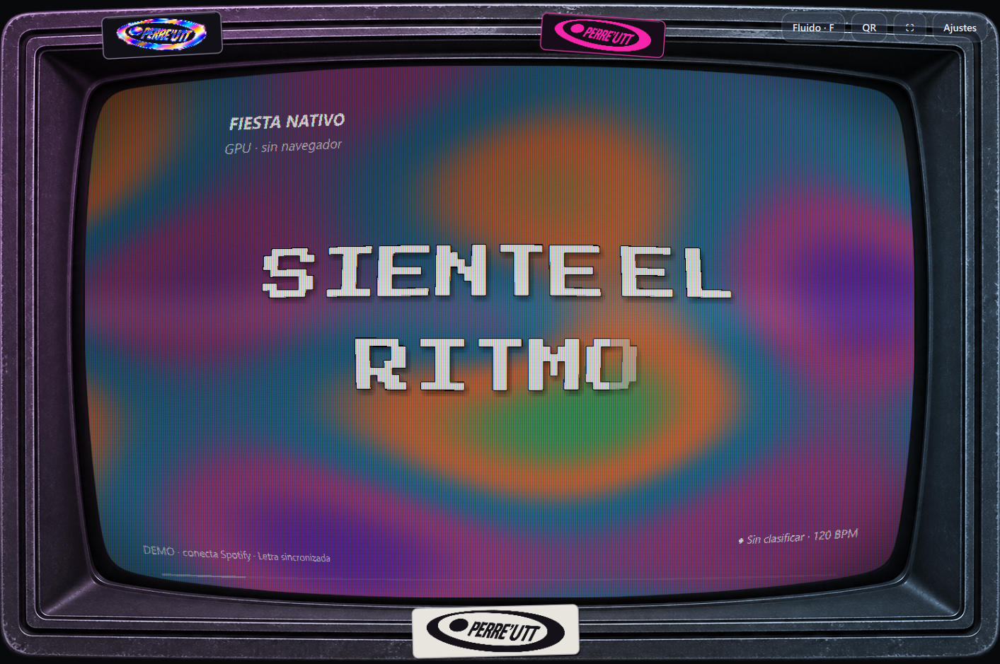

<div align="center">

# PERRE’UTT · FIESTA Native

**Tu música. Una TV de otro planeta.**

Letras sincronizadas · percusión reactiva · cultura latina

[](https://github.com/samumorantes/PERREUTT-VISUALIZER/actions/workflows/native.yml)




[Descargas](https://github.com/samumorantes/PERREUTT-VISUALIZER/releases) · [Guía de uso](DESKTOP.md) · [Linux y macOS](docs/PLATFORMS.md) · [Funciones](desktop/FEATURE_PARITY.md)

</div>

FIESTA convierte la música que escuchas en una pantalla de karaoke con estética
CRT. La edición **Native** es el centro del proyecto: Qt Quick dibuja con la GPU
del sistema, sin Electron, Chromium ni WebView. Spotify reproduce la música;
FIESTA acompaña el ritmo y muestra la letra.

## El mismo escenario, tres sistemas

| Sistema | Render | Percusión sin micrófono | Paquete |
| :--- | :--- | :--- | :--- |
| Windows 10/11 · x64 | Direct3D 11 | WASAPI, salida predeterminada | Instalador `.exe` |
| macOS 13+ · Apple Silicon / Intel | Metal | BlackHole 2ch + salida múltiple | `.app` dentro de `.dmg` |
| Linux · x64, Ubuntu 22.04+ o compatible | OpenGL | Monitor PulseAudio / PipeWire-Pulse | `.tar.gz` con acceso al menú |

Los paquetes se construyen en cada sistema en
[GitHub Actions](https://github.com/samumorantes/PERREUTT-VISUALIZER/actions/workflows/native.yml).
Abre una ejecución correcta y descarga el artefacto de tu plataforma; los tags
de versión publican los paquetes en **Releases**. El instalador Windows
[2.5.0](releases/FIESTA-Native-Setup-2.5.0.exe) se conserva como versión anterior.
Las compilaciones no llevan firma de editor ni notarización Apple.

## Diseñado para la pista

- **Salsa, bachata y reguetón:** presets visuales distintos, con paletas y efectos propios.
- **Flashes con percusión real:** graves y agudos, medios excluidos y sensibilidad adaptada al nivel de cada canción.
- **Karaoke y segunda pantalla:** letra sincronizada y ventana independiente con traducción como texto principal.
- **Cambios de canción cubiertos:** título, portada y letra se actualizan detrás de la transición.
- **Cristal CRT y liquid glass:** curvatura, fósforos, scanlines, partículas y ajustes translúcidos.
- **Mueble PERRE’UTT:** grafito, cromo iridiscente y stickers compuestos con los logos originales de la asociación.
- **A tu gusto:** presets por canción/artista/álbum, calibración, mapa de ritmo, QR y calidad adaptativa.

La detección reconoce ataques y estima el tempo; no identifica instrumentos ni
garantiza detectar todos los drops. La traducción depende del servicio y sus
límites. La captura se procesa localmente: no se guarda ni se envía el audio.

## Empieza

1. Instala o extrae el paquete de tu sistema. En macOS configura primero
   [BlackHole y la salida múltiple](docs/PLATFORMS.md#macos).
2. Abre FIESTA y configura Spotify en Ajustes. Tu app de Spotify necesita el
   redirect URI `http://127.0.0.1:8888/callback`.
3. Reproduce música en el mismo equipo y elige **Ritmo → Percusión del sistema**.

Los datos personales se guardan fuera del programa. Consulta las
[rutas y requisitos](docs/PLATFORMS.md).

## Construir

Python **3.11** de 64 bits. Compila en el sistema y arquitectura de destino.

```sh
python3 -m venv .venv-desktop
source .venv-desktop/bin/activate
python -m pip install -r requirements-desktop.txt
python scripts/build_native.py
python scripts/package_native.py
```

En Windows: `setup_desktop.ps1` y `build_installer.ps1 -Version 2.6.0`.
La [guía multiplataforma](docs/PLATFORMS.md) detalla las bibliotecas de Linux,
los permisos de macOS y cómo ejecutar desde el código.

## Dentro de FIESTA

| Pieza | Responsabilidad |
| :--- | :--- |
| [desktop](desktop/) | Escenas Qt Quick, control, presets y sincronización visual |
| [percussion.py](percussion.py) | Captura de salida y análisis local de transitorios |
| [native_platform.py](native_platform.py) | Selección de dispositivo, GPU y rutas de datos |
| [server.py](server.py) | Spotify, letras y datos compartidos; no dibuja la interfaz nativa |
| [scripts](scripts/) | Compilación, empaquetado y comprobación del ejecutable |

La edición web queda como [referencia histórica](docs/WEB-LEGACY.md).
Los nuevos desarrollos se centran en Native.

---

Dirección visual **PERRE’UTT** · [Origen del mueble](desktop/artwork/README.md) ·
[Cambios](CHANGELOG.md) · [Avisos y licencias de terceros](THIRD_PARTY_NOTICES.md)
